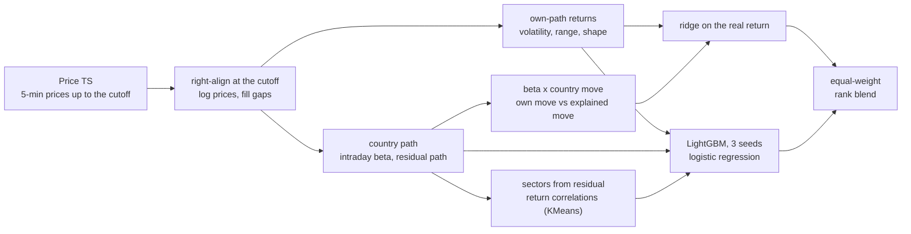

# Beating the country in the last 30 minutes

**8th of 37 teams at the QRT × Analytics Club ETH Zürich Data Challenge (Kaggle, 24 November 2026).**

[Competition on Kaggle](https://www.kaggle.com/competitions/qrt-x-eth-hackathon-24-11-2026) (invite-only, visible to participants) ·
[Write-up](docs/METHOD.md) ·
[Team](#team)

Two hours, one Kaggle competition set by Qube Research & Technologies: for 386 European stocks,
predict whether each one will beat or trail its own country over the last 30 minutes of the
trading day, using only its 5-minute prices up to that point. Every stock-day is scored on the
sign, weighted by the size of the move.

## At a glance

- **Result:** private weighted accuracy **0.5436**, 8th of 37 teams, 0.002 behind the winner.
  The top eight finished within about 0.2 points of each other.
- **Signal:** short-horizon idiosyncratic reversal. We split each stock's move into a
  beta-driven part and its own part. Only its own part reverts by the close.
- **Validation:** we spotted early that the public leaderboard was scoring the training rows,
  ignored it, and chose every submission on day-grouped cross-validation. The baseline topped
  our public scores and finished last on the private test set. Our best-CV blends were also
  our best private scores.
- **Engineering:** a tested Python toolkit (88% coverage, CI) written before the event. On the
  day, only the problem spec and the features were new. All 112 runs share the same day-grouped
  folds and the same metric, and each is saved with its out-of-fold predictions so that any
  run can be blended with any other.

## Results

| | weighted accuracy on the private test set (199 days) |
|---|---|
| Host benchmark: reverse the last 5-minute move | 0.5227 (train) |
| Our LightGBM baseline | 0.5337 |
| Our ridge on intraday features | 0.5377 |
| Our LightGBM on residual-path features with recovered sectors | 0.5419 |
| **Our final rank blend** | **0.5436** |
| Winning team | 0.5456 |

Final private leaderboard, top eight: 0.5456, 0.5450, 0.5442, 0.5440, 0.5438, 0.5437, 0.5437,
**0.5436 (us)**. Always-up and always-down both score 0.5000, so the whole field competed over
an edge of about 4 to 5 points.

## Approach



1. **Isolate the stock's own move.** The target is already relative to the country, so what
   matters is the part of a stock's late-session move that its beta to the country does not
   explain. We fit a per-day intraday beta to the equal-weighted country path and add
   `beta × country move` terms, so a linear model can separate the two parts. Dropping those
   two columns costs the ridge model 0.55 accuracy points, the largest single effect we found.
2. **Recover the missing sector structure.** The data has no sector column, so we clustered the
   stocks on the correlation of their country-residual 5-minute returns (KMeans, K = 25,
   features only, never the target) and added stock-vs-sector and sector-vs-country moves. That
   took LightGBM from 0.5416 to 0.5436 in CV.
3. **Use models that suit a weak, nearly linear signal.** Ridge regression on the raw return
   (CV 0.5420) beat LightGBM on the same features (0.5372). The trees only caught up with the
   richer residual-path features and three-seed bagging.
4. **Blend models that make different mistakes.** An equal-weight rank average of the sector
   LightGBM, a sector logistic regression and the ridge gave our best private score. The ridge
   and the LightGBM agree on only 82% of predicted signs.

We also tried a 1D CNN and a GRU over the price path, an MLP, and the supervised-autoencoder
MLP from the
[Jane Street Market Prediction](https://www.kaggle.com/competitions/jane-street-market-prediction)
1st-place solution
([notebook](https://www.kaggle.com/code/gogo827jz/jane-street-supervised-autoencoder-mlp)), all
trained on the Apple-Silicon GPU inside the same folds. None beat the linear model on this
signal. The full list of negative results is in the write-up.

## Validation and overfitting control

- **Folds of whole days.** Rows of one day share the market move, so cross-validation holds out
  whole days (5 date-block folds), and every model is scored with the competition's own
  weighted accuracy.
- **A leaderboard that scored the training rows.** Our baseline scored 0.6631 on the public
  leaderboard, exactly its in-sample accuracy on the training ids, against 0.5329 in CV. From
  then on the public score played no part in any decision.
- **Distribution shift.** Adversarial validation separates train from test days with AUC 0.84:
  the test period is later, calmer and has more stocks per day. Every candidate was re-scored on
  the most test-like training days before it was submitted.
- **Selection checks.** A day bootstrap (2,000 resamples) showed the top candidates were
  statistically tied. Re-running CV on three fresh random partitions of the days showed that
  two post-processing tweaks only helped on the folds they were tuned on, so we dropped them.

**[docs/METHOD.md](docs/METHOD.md)** has the full write-up: data audit, processing pipeline,
every CV number with its run id, the negative results, and the CV-vs-public-vs-private table
for all ten submissions.

## Repository

```
src/qrtc/                 tested toolkit: spec loading, leak-safe CV, 16 metrics, model zoo,
                          CV loop with OOF/test predictions, run registry, blending, submission
                          validation, EDA with leakage checks and adversarial validation
competition.toml          the problem spec every script reads (files, target, metric, CV)
experiments/
  intraday_ridge/         feature builder, ridge, neural nets, robustness checks, feature variants
  residual_gbm/           residual-path features, recovered sectors, LightGBM / logreg / ridge
  cnn_path/               1D CNN on the scale-free relative price path
  validation/             data audit, shift-aware score estimates, paired gain gate
  xgboost_gpu/            XGBoost notebooks for Colab and Kaggle GPUs
results/registry/         metadata of all 112 runs (CV mean, std, fold scores, features, params)
notebooks/                quickstart, EDA, experiment template, blend and submit
tests/                    pytest suite on five synthetic datasets shaped like past QRT challenges
docs/METHOD.md            the write-up
```

## Reproduce

Requires Python 3.12, [uv](https://docs.astral.sh/uv/) and access to the competition data, which
is not redistributed here.

```bash
make setup                                   # dependencies, git hooks, Jupyter kernel
D=data/raw/qrt-x-eth-hackathon-24-11-2026
kaggle competitions download -c qrt-x-eth-hackathon-24-11-2026 -p $D && unzip -o $D/*.zip -d $D

make prep                                    # flat baseline features (competition.toml)
make features                                # data/derived/: 45 intraday features per stock-day
make ridge                                   # ridge: CV 0.54196 ± 0.00521

# residual-path LightGBM with sectors, 3 seeds (CV 0.5436)
uv run python experiments/residual_gbm/run.py --base spec --fit-weight --seeds 3 \
    --families beta,idio --sectors 25

uv run qrtc lb                               # every run, best CV first
uv run qrtc blend RUN_A RUN_B RUN_C --method rank
make check                                   # ruff + pytest + notebook check (as in CI)
```

`make ridge` reproduces the competition-day ridge run exactly, fold by fold. The torch models
need `uv sync --extra fm` and run on Apple Silicon (MPS) or CUDA.

**Stack:** Python 3.12, pandas, NumPy, scikit-learn, LightGBM, XGBoost, PyTorch, pytest, ruff,
GitHub Actions.

## Team

**LARP STREET TRADING** on Kaggle:
[cangktan](https://www.kaggle.com/cangktan) ·
[itheclixs](https://www.kaggle.com/itheclixs) ·
[mer123haba456](https://www.kaggle.com/mer123haba456) ·
[tugrulox](https://www.kaggle.com/tugrulox)

This is an unofficial team repository, not affiliated with or endorsed by QRT or ETH Zürich.
MIT licence.
